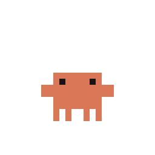
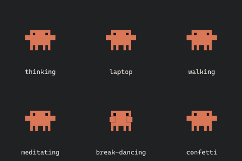

<div align="center">




# Agent Presence

**Codex and Claude Code, live on Discord.**

Animated companions · Live activity · Model · Project & Git changes

[](https://nodejs.org/)
[](https://github.com/xD-Mohamed/agent-presence/actions/workflows/test.yml)
[](LICENSE)
[](#privacy)

[Install](#install-once) · [Preview](#what-appears) · [Companions](#companions) · [Commands](#commands) · [Privacy](#privacy)

</div>

Formerly **Codex Discord RPC**. One background helper follows both assistants.

| Assistant       | Desktop | CLI | VS Code | Companion               |
| --------------- | :-----: | :-: | :-----: | ----------------------- |
| **Codex**       |    ✓    |  ✓  |    ✓    | Your selected Codex pet |
| **Claude Code** |    ✓    |  ✓  |    ✓    | Orange **Clawd**        |

Local sessions only. See [compatibility](#compatibility) for process and transcript limitations.

## Install once

### Windows — recommended

Open a **normal PowerShell terminal** as your own user and paste:

```powershell
irm https://raw.githubusercontent.com/xD-Mohamed/agent-presence/main/install.ps1 | iex
```

No Git, npm, SSH keys or manual Node installation needed. The installer downloads directly over HTTPS. It reuses compatible Node, or prepares a private Node 24.14.1 runtime with a verified official SHA-256. It does not change PATH, Git configuration or PowerShell execution policy, and does not require Administrator.

Use a regular terminal rather than an AI agent's restricted sandbox, which may block DNS, downloads, app folders or login-task registration. Keep **Discord desktop** on the same computer as your assistant.

### macOS / Linux, or an existing Node installation

Requires **Node.js 22.18+**:

```sh
npx --yes https://codeload.github.com/xD-Mohamed/agent-presence/tar.gz/main install
```

Starts in the background now and automatically at login. No Application ID, account token, API key, hooks or per-project setup.

**Windows PowerShell:** use **`npx.cmd`** instead of `npx` in npm-based examples. This avoids the blocked `npx.ps1` script. The direct HTTPS archive URL also avoids Git/SSH.

> **بالعربي:** على Windows شغّل أمر PowerShell الأول من نافذة عادية. مش لازم Administrator ولا تثبيت Node أو Git يدويًا. الأداة هتعرض نشاط Codex وClaude Code وتبدّل الشخصية تلقائيًا.

This is distributed through GitHub; `npx agent-presence` is not available until an npm registry release is published. The old GitHub repository URL redirects here and the `codex-discord-rpc` executable alias is retained.

With Node/npm already installed, try foreground mode without automatic startup:

```sh
npx --yes https://codeload.github.com/xD-Mohamed/agent-presence/tar.gz/main
```

Keep the terminal open; press **Ctrl+C** to stop.

### Updating an existing installation

Run the same Windows installer or npm `install` command above to upgrade from Codex Discord RPC. Your saved privacy options and Codex companion are preserved. Claude support is enabled automatically; no separate helper or uninstall is needed.

## What appears

**Working with Claude Code**

```text
Claude Code
Editing code · Claude Opus 4.6
Project: My App  |  +400 −50
⏱ Elapsed time
```

**Working with Codex**

```text
ChatGPT Codex
Thinking · GPT-6 Astra · High
Project: My App  |  Git clean
⏱ Elapsed time
```

- **Identity:** Claude Code with orange Clawd, or ChatGPT Codex with the selected Codex companion.
- **Activity:** thinking, planning, editing, reading, searching, testing, running commands, waiting, idle, ready or needs attention, as available in local session records.
- **Model:** the model from the session. Codex reasoning effort is shown when available; Claude effort is omitted when unavailable.
- **Project:** only the folder basename; generated Codex projectless folder names are hidden.
- **Git:** staged + unstaged tracked changes against HEAD, refreshed at most every 10 seconds. Untracked and binary files are excluded. After committing, the card shows `Git clean`.

The oldest active real project keeps the card until it finishes, including across assistants. Real projects take priority over projectless chats. There is no rotation; a second publisher cannot compete with the first.

When work finishes, supported open native apps/backends retain an **Idle** card with the last observed metadata. Confirmed closure clears it. Ten minutes without recognized Claude activity expires stale work. Process detection reads executable paths only, never arguments or window titles. Generic VS Code alone does not mean either extension is running.

Discord controls layout and may ignore the requested activity name. The shared registered application is currently **Codex AI**, configured separately in the Discord Developer Portal; the payload requests **Claude Code** or **ChatGPT Codex**. Renaming this repository does not change that external setting.

## Companions

Clawd now uses **25 complete ready-made animation sequences — 1,093 source frames**, plus three mirrored walking/running variants (**28 transparent GIFs**). These replace the simple nine-loop rendition from 0.4.0. The sprite data comes from [Claude Pet](https://github.com/yuyongyan29-dev/claude-pet/tree/92af7cea39e4331019c41341d90d486cb6f00784), whose notice attributes the artwork to Anthropic's Claude desktop app.



| Activity                              | Clawd animations                                          |
| ------------------------------------- | --------------------------------------------------------- |
| Thinking / reviewing                  | Thinking, looking around                                  |
| Planning                              | Lightbulb, pointing                                       |
| Editing / working                     | Laptop, desktop computer                                  |
| Searching / running                   | Walking, crab walking, running, both directions           |
| Testing                               | Jumping, happy jumping                                    |
| Organizing context / creating artwork | Meditating, spark effect                                  |
| Waiting / ready                       | Waving, pointing / confetti, happy dance, excited         |
| Needs attention                       | Disappointed, facepalm, dizzy                             |
| Idle                                  | Swaying, eyes looking around, turning, hula, breakdancing |

Multiple clips for the same activity alternate every 30 seconds. The selected project stays fixed. Each GIF contains its complete sequence, including repeated frames and transparency; integer pixel scaling keeps edges sharp, and centisecond timing preserves the source's 12 fps without speeding it up. The standard lifecycle still becomes Idle when a native app finishes; the Ready clips apply when a completed snapshot is displayed.

[Browse all 28 GIFs](artwork/claude-native/clawd) · [Source and frame manifest](artwork/claude-native/clawd/manifest.json)

| Thinking                                                                       | Working                                                                     | Waiting                                                                     | Finished                                                                       |
| ------------------------------------------------------------------------------ | --------------------------------------------------------------------------- | --------------------------------------------------------------------------- | ------------------------------------------------------------------------------ |
|  |  |  |  |

Codex companions keep their own look:

   

Codex retains the original application frames and native timing. Supported Codex pets: `codex`, `dewey`, `fireball`, `hoots`, `rocky`, `seedy`, `stacky`, `bsod`, `null-signal`. The active supported pet is used; if disabled or unsupported, the last supported pet or default Codex companion is used. Custom pets are never uploaded. Only Codex cards show the ChatGPT badge.

```sh
npx --yes https://codeload.github.com/xD-Mohamed/agent-presence/tar.gz/main install --pet null-signal
```

`--pet` overrides only Codex; Claude always uses Clawd. `--artwork-base URL` accepts a public HTTPS directory containing `<codex-pet>/<animation>.gif` and `clawd/<animation>.gif`. `--no-image` hides all artwork.

## Commands

With Node/npm installed, use the `npx --yes https://codeload.github.com/xD-Mohamed/agent-presence/tar.gz/main` prefix (`npx.cmd` on Windows):

| Add this           | Result                                              |
| ------------------ | --------------------------------------------------- |
| `install`          | Install/update background runtime and login startup |
| `start`            | Start an installed runtime                          |
| `stop`             | Stop and clear presence; keep login startup         |
| `uninstall`        | Remove managed startup/runtime; keep remembered pet |
| `--dry-run --once` | Preview only the public payload without Discord     |
| `--help`           | Show options                                        |

Options: `--hide-project`, `--hide-model`, `--hide-diff`, `--no-image`, `--pet NAME`, `--codex-home PATH`, `--claude-home PATH`, `--artwork-base URL`.

```sh
npx --yes https://codeload.github.com/xD-Mohamed/agent-presence/tar.gz/main install --hide-project --hide-diff
```

With private Node on Windows, the installer prints an offline control command. You can also use:

```powershell
$record = Get-Content "$env:LOCALAPPDATA\Programs\Codex Discord RPC\install-record.json" -Raw | ConvertFrom-Json
& $record.node "$env:LOCALAPPDATA\Programs\Codex Discord RPC\src\cli.js" stop
```

Replace `stop` with `start` or `uninstall`. To pass privacy options to the direct installer:

```powershell
$installer = irm https://raw.githubusercontent.com/xD-Mohamed/agent-presence/main/install.ps1
& ([scriptblock]::Create($installer)) -Options @('--hide-project', '--hide-diff')
```

Reinstalling without flags preserves saved options. Explicit homes and `CODEX_HOME` / `CLAUDE_CONFIG_DIR` are saved as absolute paths for login startup. Neither assistant's settings, sessions or projects are modified.

## Compatibility

| Assistant / surface | Activity source                                                               |
| ------------------- | ----------------------------------------------------------------------------- |
| Codex Desktop       | Read-only SQLite history, JSONL fallback                                      |
| Codex CLI / VS Code | Local Codex session records                                                   |
| Claude Code Desktop | Parent JSONL records marked `claude-desktop`                                  |
| Claude Code CLI     | Parent JSONL records marked `cli`, including older records without entrypoint |
| Claude Code VS Code | Parent JSONL records marked `claude-vscode` or `vscode`                       |

Codex uses `~/.codex`, `CODEX_HOME` or `--codex-home`. Claude uses `~/.claude/projects/*/*.jsonl`, `CLAUDE_CONFIG_DIR` or `--claude-home`. See [Claude's data-directory documentation](https://code.claude.com/docs/en/claude-directory). Subagents, SDK sessions and unknown Claude entrypoints are excluded. Internal schemas can change; unsupported records are omitted. Disabled transcript persistence prevents task detection.

Older npm-based Claude runs under Node: fresh transcript activity works, but a generic Node process cannot confirm persistent CLI Idle or immediate closure. Native CLI installations support process-based liveness. Remote/SSH, cloud and WSL-hosted sessions require data and processes accessible in the same environment as Discord; automatic remote bridging is not implemented.

Windows uses a least-privilege per-user Task Scheduler logon task and a windowless .NET launcher compiled from the bundled C# source. It starts Node with `CreateNoWindow`, drains output and does not open a console. No password, VBS, PowerShell startup wrapper or elevated task is used. macOS uses a LaunchAgent; Linux uses XDG autostart. Node must remain at its recorded path; reinstall after moving it. Downloaded private Node lives in `%LOCALAPPDATA%\Programs\Agent Presence Runtime` and remains on uninstall for reinstalls; system Node is unchanged.

For upgrade compatibility, **Agent Presence keeps the existing installer directories, identifiers, task names and local control protocol**. Windows files remain in `%LOCALAPPDATA%\Programs\Codex Discord RPC`; the task is `CodexDiscordRPC-<installation-id>`. macOS/Linux retain their `codex-discord-rpc` locations. This updates one existing publisher and keeps preferences. Legacy Windows options/pet are imported only when no current record exists; unrelated files and old runtime files remain untouched. Uninstall removes only recorded managed files and the managed startup entry.

## Privacy

Only assistant identity, a fixed status label, optional model/effort, project basename, numeric tracked Git totals, timestamp and public artwork URLs are sent to Discord.

**Never sent:** prompts, reasoning text, responses, filenames, file contents, full paths, session/account IDs, usage/quota, credentials or tokens.

JSONL bodies can pass through the local parser and bounded partial-line buffer, but are not logged or included in public payloads. Tool commands are classified, never executed. Git disables external diffs/text conversion. Runtime has no HTTP client, telemetry or API requests; it talks to local Discord IPC. Discord fetches public immutable artwork URLs. The reader never opens `auth.json` or `.credentials.json`.

## Troubleshooting

- **`npx.ps1 cannot be loaded` / `PSSecurityException`:** use `npx.cmd` or the direct Windows installer. No execution-policy change is needed.
- **npm code 128 / Git or SSH error:** use the direct HTTPS archive URL or direct Windows installer; no global Git rewrite or SSH key is required.
- **`ENOTFOUND registry.npmjs.org` / npm cache denied:** the direct Windows installer does not use the npm registry or npm cache. If GitHub/Node downloads are also blocked, check DNS/network access and run outside the agent sandbox. Downloads stop after three attempts with the failing host and next steps. The installer cannot grant OS or organization permissions.

- **No activity:** open Discord desktop and the assistant/backend, then run `--dry-run --once`. Unsupported process layouts or internal session schemas may prevent detection.
- **Idle after work:** expected while a supported native surface stays open. New work replaces Idle automatically.
- **Duplicate instance:** use `stop`, then `start`. One publisher serves both assistants.
- **Startup:** check the `CodexDiscordRPC-…` task on Windows. Managed devices may block login-task creation. Try foreground mode for a diagnostic.
- **npm `EPERM` / `TAR_ENTRY_ERROR`:** check antivirus notifications; if none match, try an isolated npm cache. Do not disable protection or add exclusions to force installation.
- **Antivirus notice:** keep protection enabled and retain the detection name, path and file hash. No antivirus approval or binary-signing claim is made; see [SECURITY.md](SECURITY.md).

## Development

```sh
npm ci
npm test
npm run check
node scripts/build-artwork.js /path/to/v2-sprites artwork/natural
node scripts/build-clawd.js
node scripts/preview-clawd.js
npm pack --dry-run
```

The Windows startup integration test requires an isolated machine with no running publisher. On an active workstation run unit tests separately and leave that test to CI. GitHub CI covers Linux/Windows on Node 22.18 and 24, plus npm GitHub/HTTPS installation and direct Windows install/update/control/removal with Node, npm and Git absent from PATH. The private runtime checksum and SQLite capability are verified before startup. Full interactive reboot and real macOS/Linux login startup are not covered.

See [AGENTS.md](AGENTS.md) for architecture and [THIRD_PARTY.md](THIRD_PARTY.md) for attribution. Source code is MIT; OpenAI/Anthropic characters and trademarks are not relicensed. This is an unofficial community integration, not an OpenAI, Anthropic or Discord product.
